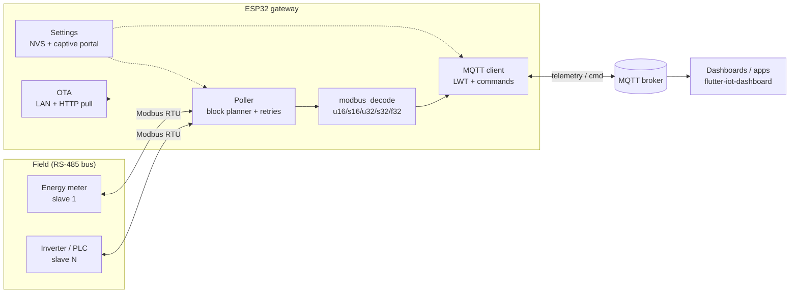
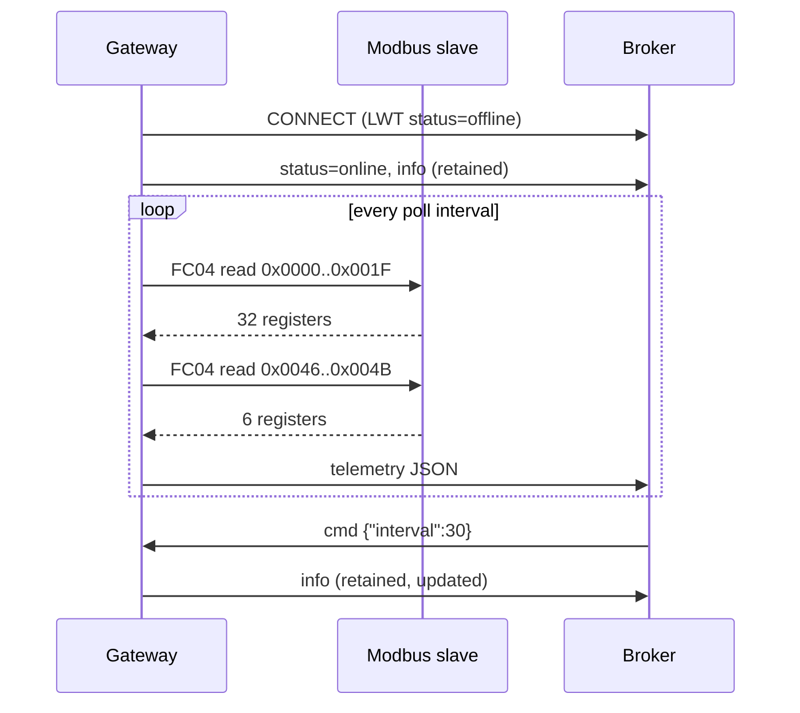

# esp32-modbus-mqtt-gateway

[](https://github.com/alveskevinn/esp32-modbus-mqtt-gateway/actions/workflows/ci.yml)


ESP32 firmware that polls a **Modbus RTU** device over **RS-485** (an energy meter, an inverter, a PLC) and publishes its readings as JSON on **MQTT**. Wi-Fi, broker and Modbus settings are set in a **captive portal**, so no reflash is needed. Updates go over the air (**OTA**), and an optional **deep sleep** mode suits battery or solar installs.

```text
$ mosquitto_sub -t 'devskin/gateways/#' -v
devskin/gateways/mbgw-3a91f0/status online
devskin/gateways/mbgw-3a91f0/telemetry {"ts":1762190400,"slave":1,"ok":true,"values":{"voltage":229.84,"current":4.12,"active_power":918.3,"power_factor":0.97,"frequency":60.01,"import_energy":1532.7},"errors":0,"polls":412,"rssi":-58,"uptime_s":4120}
```

## Why

Most of the machines and meters still running on factory floors speak Modbus RTU and nothing else. Retrofitting them for remote monitoring usually means one of two things: an industrial gateway that costs more than the meter, or a fragile script on a PC beside the cabinet. This firmware is the small, cheap middle option. It runs on a ~US$5 microcontroller, survives power and network drops, and is configured on site from a phone.

## Features

- **Batched reads:** the register map is grouped into as few FC03/FC04 requests as possible. Small gaps are read through, and each request stays within the 125-register limit.
- **Typed decoding:** `u16`, `s16`, `u32`, `s32` and IEEE-754 `float32`, with selectable word order (`ABCD` / `CDAB`) and a scale factor per point.
- **Captive portal** (WiFiManager): Wi-Fi, MQTT broker and credentials, base topic, slave id, baud rate, poll interval and deep sleep. Hold **BOOT** during reset to reopen it.
- **Resilient MQTT:** a retained `status` topic with LWT (`online` / `offline`), automatic reconnects, and remote commands on `cmd`.
- **OTA two ways:** ArduinoOTA on the LAN, or HTTP(S) pull triggered over MQTT (`{"ota_url": "..."}`).
- **Deep sleep mode:** wake, read, publish, sleep. Useful on battery or solar sites with a slow-changing signal.
- **Host-side unit tests** for decoding and block planning (`pio test -e native`), run in CI next to both firmware builds.

## Architecture





### MQTT topics

`<t>` = `<base topic>/<device id>`. The defaults are `devskin/gateways` and `mbgw-<last 3 MAC bytes>`.

| Topic | Dir | Retained | Payload |
|---|---|---|---|
| `<t>/status` | out | yes | `online`, `offline` (LWT), `updating` |
| `<t>/info` | out | yes | firmware, IP, RSSI, slave, baud, intervals and point → unit map |
| `<t>/telemetry` | out | no | `{"ts", "slave", "ok", "values": {...}, "errors", "polls", "rssi", "uptime_s"}` |
| `<t>/cmd` | in | no | `{"interval": 30}` · `{"reboot": true}` · `{"portal": true}` · `{"ota_url": "https://…/firmware.bin"}` |

A point that failed to read is **left out** of `values`, never sent as `0`, so consumers can tell "zero" from "unknown". `ts` only appears once SNTP has synced.

### Register map

Edit [`include/register_map.h`](include/register_map.h). The bundled example is the common map used by single-phase DIN-rail energy meters (input registers, float32, high word first):

```cpp
constexpr Point POINTS[] = {
    {"voltage",       Function::Input, 0x0000, RegType::F32, 1.0, "V"},
    {"current",       Function::Input, 0x0006, RegType::F32, 1.0, "A"},
    {"active_power",  Function::Input, 0x000C, RegType::F32, 1.0, "W"},
    // ...
    {"import_energy", Function::Input, 0x0048, RegType::F32, 1.0, "kWh"},
};
```

For a device that sends `2301` to mean 230.1 V, use `RegType::U16` with scale `0.1`. Keep the array sorted by function and address so reads batch well.

## Hardware / BOM

| Qty | Part | Notes |
|---|---|---|
| 1 | ESP32 DevKit V1 (WROOM-32) **or** ESP32-C3 SuperMini | both are build targets |
| 1 | RS-485 transceiver: **MAX3485 / SP3485** (3.3 V) | avoid 5 V MAX485 boards on 3.3 V logic, or level-shift RO |
| 1 | 120 Ω resistor | termination at the bus end, if not already on the module |
| 1 | 5 V or 3.3 V DIN-rail PSU (e.g. HLK-PM01 + enclosure) | |
| 1 | Twisted pair (shielded for long runs) | A/B plus a common GND reference |
| 1 | Modbus RTU device | energy meter, inverter, VFD, PLC |

### Wiring (ESP32 DevKit V1)

| ESP32 | RS-485 module | Device |
|---|---|---|
| GPIO17 (TX) | DI | |
| GPIO16 (RX) | RO | |
| GPIO4 | DE + /RE (tied) | |
| 3V3 / GND | VCC / GND | GND (reference) |
| | A / B | A (+) / B (−) |

On the ESP32-C3 the pins are RX=6, TX=7, DE=10 and portal button=9. Override any pin with `-D` in `platformio.ini`. For modules with automatic direction control, set `-DRS485_DE_GPIO=-1`.

## How to run

```bash
# Prerequisite: PlatformIO Core (pip install platformio) or the VS Code extension
git clone https://github.com/alveskevinn/esp32-modbus-mqtt-gateway
cd esp32-modbus-mqtt-gateway

pio test -e native                 # unit tests on your machine
pio run -e esp32dev -t upload      # or: -e esp32c3
pio device monitor
```

1. On first boot the board opens a Wi-Fi network named `MB-Gateway-XXXXXX`. Join it and the portal opens. If it doesn't, browse to `192.168.4.1`.
2. Choose your Wi-Fi network and fill in the broker, slave id and baud rate, then save.
3. Watch the readings:

```bash
docker run -d --name mosquitto -p 1883:1883 eclipse-mosquitto:2 \
  mosquitto -c /mosquitto-no-auth.conf
mosquitto_sub -h localhost -t 'devskin/gateways/#' -v
mosquitto_pub -h localhost -t 'devskin/gateways/<id>/cmd' -m '{"interval":5}'
```

### OTA

- **LAN:** `pio run -e esp32dev -t upload --upload-port <device-ip>`. Add `upload_protocol = espota` and `upload_flags = --auth=<ota password>` to the environment.
- **Pull:** host the `.bin` from `.pio/build/<env>/firmware.bin`, then publish `{"ota_url":"https://host/firmware.bin"}` to `<t>/cmd`.

OTA is disabled in deep sleep mode, because the board is offline most of the time. Hold BOOT on reset to reach the portal instead.

## Security

- Turn on broker authentication. Credentials are stored in NVS. Enable [flash encryption](https://docs.espressif.com/projects/esp-idf/en/stable/esp32/security/flash-encryption.html) on devices you ship.
- HTTPS OTA uses `setInsecure()` for simplicity. In production, pin your CA with `setCACert()` and sign the images.
- The portal is open (no password) for the 3 minutes it stays up. Set `wm.setConfigPortal(..., password)` if physical access is a concern.

## Roadmap

Planned work is tracked in [issues](https://github.com/alveskevinn/esp32-modbus-mqtt-gateway/issues): multiple slaves per bus, Home Assistant MQTT discovery, register maps loaded from JSON, and Modbus writes over MQTT.

## License

[MIT](LICENSE) © Kevin Pedroso · [DevSkin](https://devskin.com)
